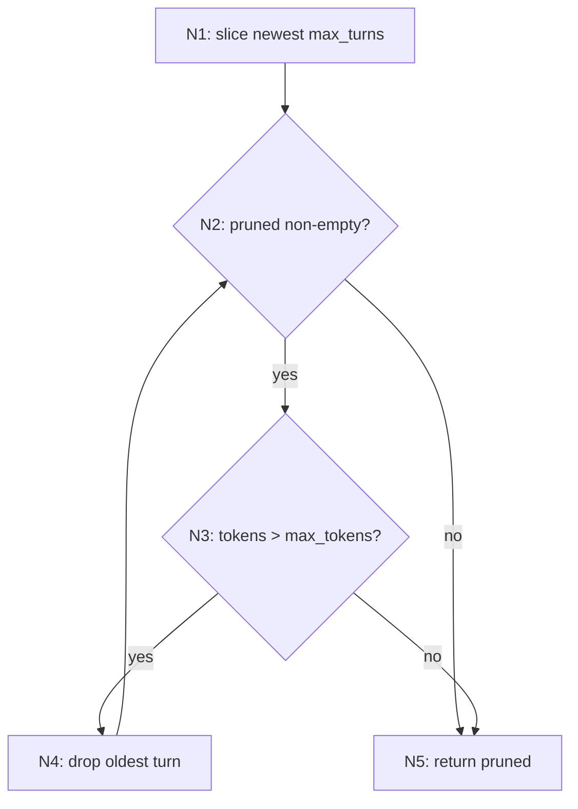

# White-box test design: `ContextPruner.prune` (SE431)

Derived from the built code in `backend/services/context_pruner.py` on branch `feature/context-pruner`
(re-check against the final merged version before submission; add a draw.io screenshot of the CFG).

```python
def prune(self, turns):
    pruned = turns[-self.max_turns:]                                   # N1
    while pruned and self._total_tokens(pruned) > self.max_tokens:    # N2: pruned? / N3: over budget?
        pruned = pruned[1:]                                            # N4
    return pruned                                                      # N5
```

## Control flow graph

Nodes N = 5, edges E = 6 (N1-N2, N2-N3, N2-N5, N3-N4, N3-N5, N4-N2).
**V(G) = E - N + 2 = 6 - 5 + 2 = 3**, equal to decisions + 1 (the `and` counts as two decisions: 2 + 1 = 3). Below the refactor threshold of about 10.

## Basis paths and tests
| Path | Route | Input idea | Test (backend/tests/test_context_pruner.py) | Requirement |
|---|---|---|---|---|
| P1 | N1-N2(no)-N5 | empty history | `test_empty_history_returns_empty_list` | REQ-F03 |
| P2 | N1-N2(yes)-N3(no)-N5 | fits both limits | `test_fewer_turns_than_limit_are_all_kept` | REQ-F03 |
| P3 | N1-N2(yes)-N3(yes)-N4-N2... | over token budget, oldest dropped | `test_token_budget_drops_oldest_turns_until_it_fits` | REQ-F03 |

Extra: `test_single_turn_larger_than_token_budget_is_dropped` drives the loop back to N2(no); the property test exercises all paths with 200 random inputs.

## Constructor `ContextPruner.__init__`
Two decisions (`max_turns <= 0`, `max_tokens <= 0`) give V(G) = 3. Paths: valid; invalid max_turns; invalid max_tokens, covered by the parametrized `ValueError` tests.

## Still to do
`SessionManager.get_pruned_context` and the `GeminiAdapter` error mapping (Nazaar's code): draw CFG, compute V(G), derive paths once those files are final on `main`.
