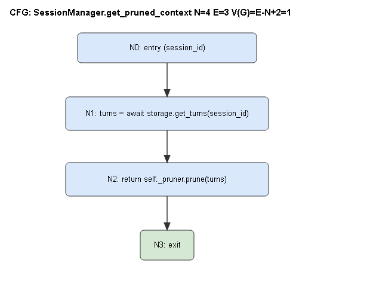
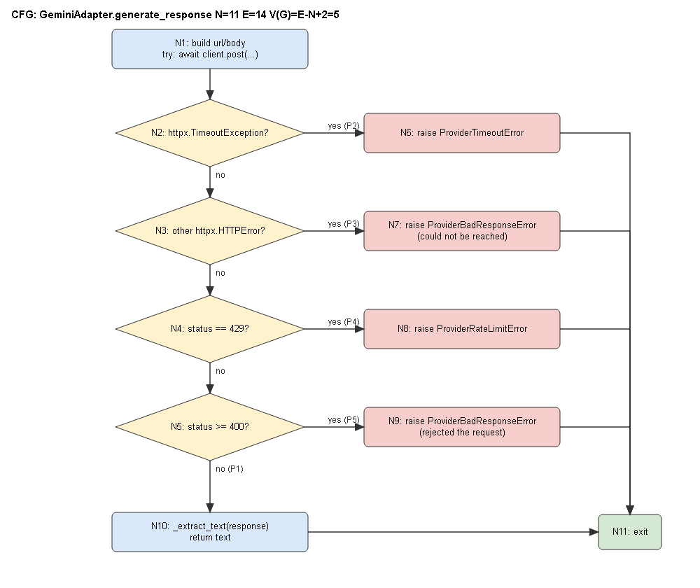
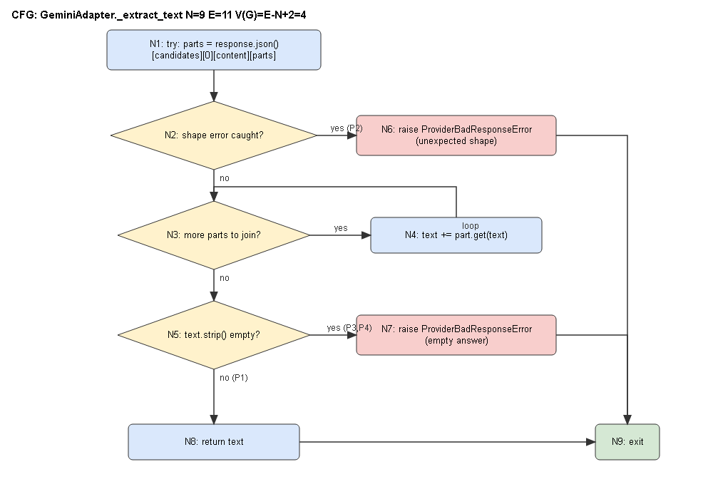

# White-box test design: SessionManager.get_pruned_context and GeminiAdapter error mapping (SE431)

Derived from the final code on `main` (commit `27c7740`): `backend/database/session_manager.py` and `backend/services/gemini_adapter.py`.
Companion to `whitebox-context-pruner.md`. Tests: `backend/tests/test_whitebox_paths.py` (one named test per basis path).

## Method
1. Draw the control flow graph (nodes = statement blocks and decisions, edges = flow). Drawn in draw.io format (`docs/sqa/cfg/*.drawio`), exported to PNG.
2. Cyclomatic complexity V(G) = E - N + 2 (equals decisions + 1; every `except` clause and every comprehension loop counts as a decision).
3. Cross-check with the `radon cc` tool run on the same files (`pip install radon`; `radon cc -s <files>`).
4. List V(G) independent basis paths and write one named test per path, each traced to a requirement.

| Function | N | E | V(G) = E-N+2 | radon cc | Verdict (threshold about 10) |
|---|---|---|---|---|---|
| `SessionManager.get_pruned_context` | 4 | 3 | 1 | A (1) | no decisions, nothing to refactor |
| `GeminiAdapter.generate_response` | 11 | 14 | 5 | A (5) | fine |
| `GeminiAdapter._extract_text` | 9 | 11 | 4 | A (4) | fine |
| `ContextPruner.prune` (see other doc) | 5 | 6 | 3 | A (3) | fine |

## 1. SessionManager.get_pruned_context (REQ-F03)

Straight-line code, so one basis path. The "unknown session" case is not a branch here: `storage.get_turns` returns `[]` and the pruner handles it
(covered by `test_session_with_no_turns_gives_the_pruner_an_empty_history` in `test_session_manager.py`).

| Path | Route | Test |
|---|---|---|
| P1 | N0-N1-N2-N3 | `test_wb_get_pruned_context_path1_reads_storage_then_returns_the_pruned_turns` |

## 2. GeminiAdapter.generate_response (REQ-Q02)

| Path | Route | Outcome | Test |
|---|---|---|---|
| P1 | N1-N2(no)-N3(no)-N4(no)-N5(no)-N10-N11 | answer text returned | `test_wb_generate_response_path1_success_returns_the_text` |
| P2 | N1-N2(yes)-N6-N11 | `ProviderTimeoutError` | `test_wb_generate_response_path2_timeout_raises_provider_timeout_error` |
| P3 | N1-N2(no)-N3(yes)-N7-N11 | `ProviderBadResponseError` (could not be reached) | `test_wb_generate_response_path3_other_http_error_raises_provider_bad_response_error` |
| P4 | N1-N2(no)-N3(no)-N4(yes)-N8-N11 | `ProviderRateLimitError` | `test_wb_generate_response_path4_status_429_raises_provider_rate_limit_error` |
| P5 | N1-N2(no)-N3(no)-N4(no)-N5(yes)-N9-N11 | `ProviderBadResponseError` (rejected) | `test_wb_generate_response_path5_status_500_raises_provider_bad_response_error` |

## 3. GeminiAdapter._extract_text (REQ-Q02)

| Path | Route | Outcome | Test |
|---|---|---|---|
| P1 | N1-N2(no)-N3(yes)-N4-N3(no)-N5(no)-N8-N9 | joined text returned | `test_wb_extract_text_path1_joins_the_parts_and_returns_the_text` |
| P2 | N1-N2(yes)-N6-N9 | `ProviderBadResponseError` (unexpected shape) | `test_wb_extract_text_path2_unexpected_shape_raises_provider_bad_response_error` |
| P3 | N1-N2(no)-N3(yes)-N4-N3(no)-N5(yes)-N7-N9 | `ProviderBadResponseError` (blank text) | `test_wb_extract_text_path3_blank_text_raises_provider_bad_response_error` |
| P4 | N1-N2(no)-N3(no, loop body never runs)-N5(yes)-N7-N9 | `ProviderBadResponseError` (no parts) | `test_wb_extract_text_path4_zero_parts_raises_provider_bad_response_error` |

## Evidence (run 2026-11-19 on the final code)
- `pytest backend/tests/test_whitebox_paths.py`: 10 passed; full backend suite: 196 passed.
- Statement and branch coverage of the three modules (`pytest --cov-branch`): `session_manager.py` 100%, `context_pruner.py` 100%, `gemini_adapter.py` 98%
  (the single uncovered line is `aclose()`, which is not an error-mapping path).
- The existing `test_gemini_adapter.py` and `test_session_manager.py` already exercised these paths functionally; the white-box file makes the
  path-to-test mapping explicit and independently checkable.
